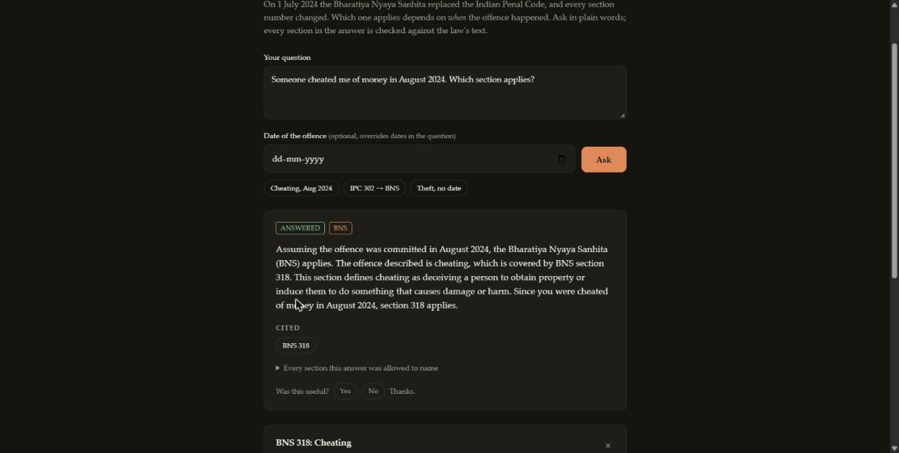
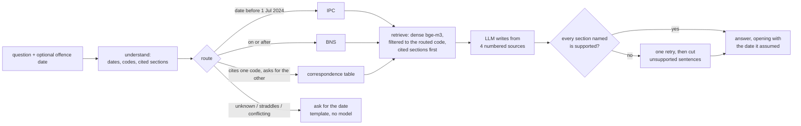

# LexBridge

On 1 July 2024 India replaced the Indian Penal Code (IPC) with the Bharatiya Nyaya Sanhita
(BNS). Every section number changed (IPC 420 is now BNS 318(4)), and which code applies
depends on **when the offence was committed**. Ask a general-purpose chatbot and you get
stale IPC numbers, with no check of the date.

LexBridge answers questions about either code. It works out which law applies from the
date, retrieves the provisions, and cites them. **Every section number in an answer is
checked against the law's text before it is shown.** When the date is missing it asks;
when the sources do not answer, it says so.



## Results

On a fixed, stratified 92-question evaluation (every hand-written case plus a sample of
each generated category; `reports/generation/gen-v3-references.json`):

| measure | result |
|---|---|
| answers naming a section their sources do not support | **0 / 92** |
| first drafts that did (caught by the checker before showing) | 0 / 92 |
| right code (IPC vs BNS) for dated questions | 100% |
| a correct section cited, of answered questions | 79.7% |
| asks for the date when it is needed (recall / precision) | 100% / 100% |
| out-of-scope questions declined | 8 / 8 |
| latency per answer, p50 / p95 | 0.94 s / 1.29 s |

Every retrieval technique had to earn its place in a measured ablation
(`reports/ablation.md`, 1,466 golden questions; hit@5 is the share whose answer is in the
top five):

| rung | hit@1 | hit@5 | wrong code first | kept? |
|---|---:|---:|---:|---|
| v0 dense (bge-m3) | 36.9 | 64.3 | 25.6% | baseline; beat e5-small by 12.6 hit@5 |
| v1 + BM25 hybrid | 36.5 | 62.5 | 12.2% | **no**: hit@5 fell, found nothing extra |
| v2 + date router | 52.0 | 69.9 | **0%** | yes: 131 cases gained, none lost |
| v3 + cited-section lookup | 54.1 | 71.9 | 0% | **yes, the default**: map questions 1% → 100% |
| v4 + cross-encoder rerank | 55.8 | 76.1 | 0% | deferred: +4 hit@5 for 13× the latency |

## How it works



The split of trust is the design:

- **Rules decide the code.** The router reads dates and act names and abstains on weak or
  conflicting evidence ("filed in 2025" is a procedural date, not an offence date). The
  model never chooses between the IPC and the BNS.
- **Retrieval decides the sources**, filtered to the routed code, with any section the
  question cites looked up directly.
- **The model only writes**, and its prose is checked: coded mentions ("BNS 318"), bare
  ones ("section 420", "s. 498A", Hindi "धारा ४२०"), sub-sections and quantities ("318(4)",
  "7 years") told apart. A section counts as supported if it is a source, cited in the
  question, in their rows of the official correspondence table, or named by a source's
  own text.
- **The assumption is stated.** Every answer opens with the date it relied on, so a misread
  date is visible, and an explicit `offence_date` overrides the text.

Why each choice was made, with the numbers, is in [`docs/decisions/`](docs/decisions/):

| ADR | decision |
|---|---|
| [0001](docs/decisions/0001-pdfplumber-not-pymupdf.md) | pdfplumber, not PyMuPDF (AGPL) |
| [0002](docs/decisions/0002-bge-m3-for-dense-retrieval.md) | bge-m3 over multilingual-e5-small |
| [0003](docs/decisions/0003-retrieval-ladder.md) | the retrieval ladder: route and look up first, rerank only if it pays |
| [0004](docs/decisions/0004-grounded-generation.md) | generation: the model writes, everything else is decided and checked |
| [0005](docs/decisions/0005-api.md) | the API, and the free tier's budget as the thing to protect |
| [0006](docs/decisions/0006-deploy-on-hold.md) | a deployable image; public hosting on hold |

## Models: free tier only

Answers are written by `openai/gpt-oss-20b`, falling back to `openai/gpt-oss-120b` and
then Gemini 2.5 Flash, all on free tiers (Groq, Google AI Studio). Groq caps tokens per
day *per model*, so the second model behind the same key doubles the daily budget.

| run (ADR 0004) | model | unsupported answers | correct section | clarify P / R |
|---|---|---:|---:|---:|
| 2 | gpt-oss-20b | 0 | 77.2% | 94.1 / 100 |
| 3 | gpt-oss-120b (84 of 92 calls) | 0 | 79.7% | 100 / 100 |

The checker was also tightened between the two runs, so they are not a controlled model
comparison. What they show is that the guarantee does not depend on the model: neither
model got an unsupported section past the checker. A paid model was not evaluated.

## Run it

Needs Python 3.11+ and a free [Groq API key](https://console.groq.com/keys).

```bash
python -m venv .venv && source .venv/bin/activate      # Windows: .venv\Scripts\activate
pip install torch==2.14.1 --index-url https://download.pytorch.org/whl/cpu
pip install -e ".[dev]"

python -m lexbridge.ingest.fetch                       # statute PDFs, pinned by SHA-256
python -m lexbridge.ingest.package v2026-10-18         # → artifacts/v2026-10-18/

export GROQ_API_KEY=...                                # GEMINI_API_KEY optional
uvicorn --factory lexbridge.api.main:build             # http://127.0.0.1:8000
```

The first start downloads bge-m3 (~2.3 GB) and embeds the 939 sections once; it needs
about 3 GB of RAM. A `Dockerfile` builds the same app as an image.

API: `POST /chat {"question", "offence_date"?}`, `GET /section/{IPC|BNS:id}`,
`GET /map/{id}`, `POST /feedback`, `GET /health`. Per client: 5 questions a minute and 50
a day; 400 model-backed answers a day across everyone; repeated questions are cached.

The page is a React app in `web/`, built into `src/lexbridge/api/static/` and committed, so
running the API needs no Node. To change it (Node 24):

```bash
cd web && npm ci
npm run dev        # http://localhost:5173/static/, API calls proxied to :8000
npm run build      # rebuild the committed page; CI fails if it is stale
```

Development gates, as in CI: `ruff check .`, `pyright`, `pytest --cov` (≥ 90%, unit tests
cannot open a network connection), `pytest -m integration` (real PDFs); for the page, `npm run typecheck` and
`npm run coverage` (≥ 80%) in `web/`. The evaluations:
`python -m lexbridge.eval.run` (retrieval) and `python -m lexbridge.eval.generation`
(answers; spends ~65k free-tier tokens, checkpointed).

## Limitations

- **Plain-language questions can get a grounded but second-best section.** "Cheated of money
  in March 2024" cited IPC 418 rather than 415/420. The checker guarantees the section is
  supported, not that it is the best one; retrieval finds the answer in the top five for
  68% of hand-written lay questions. The deferred reranker is the next lever.
- **Hindi is the weakest category**: 30% hit@5 in retrieval, a correct section in a third of
  answered Hindi questions. No retrieval stage moved it.
- **The router is rules.** Reading an offence date out of free text keeps a residual error
  rate; that is why the assumption is stated and can be overridden.
- **"Unmapped" is not "abolished".** The official table omits some sections that do have BNS
  counterparts; LexBridge never claims a section was dropped.
- **Coverage is the two penal codes only**: not the CrPC/BNSS, the Evidence Act/BSA, or
  case law.
- **Not deployed publicly** (ADR 0006): Hugging Face now charges for Docker Spaces.

General information about the Indian Penal Code and the Bharatiya Nyaya Sanhita, **not
legal advice**. Do not include personal details in questions.

Source texts, pinned by SHA-256 in `data/sources.json`: the codes from
[IndiaCode](https://indiacode.gov.in/) and [PRS Legislative Research](https://prsindia.org/);
the IPC–BNS correspondence table from the comparison summary published by Kerala Prisons.
Code licence: [MIT](LICENSE).
